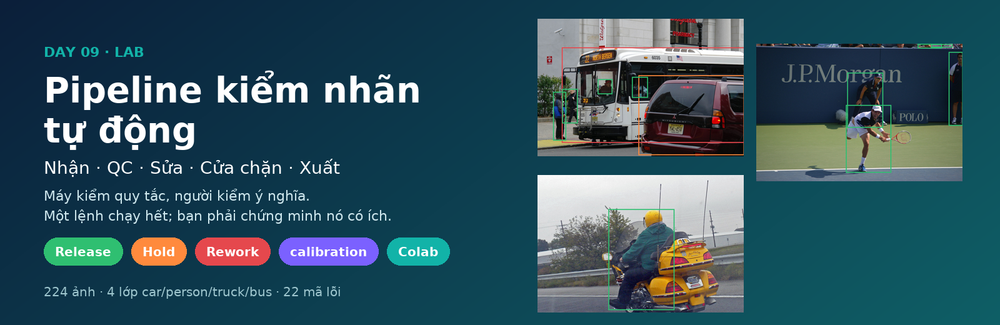
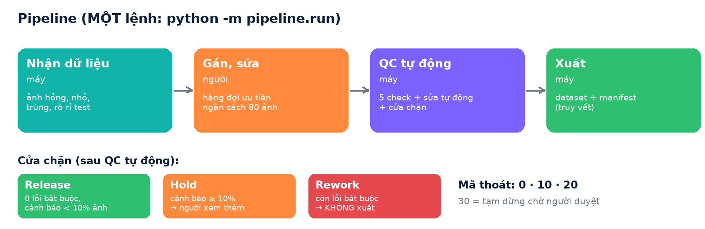
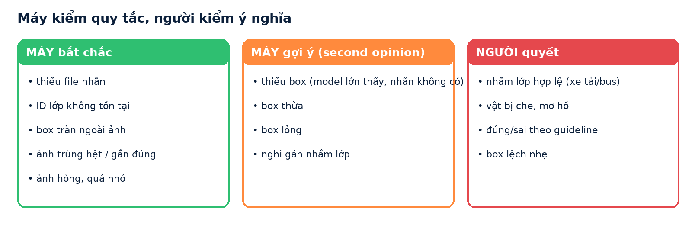
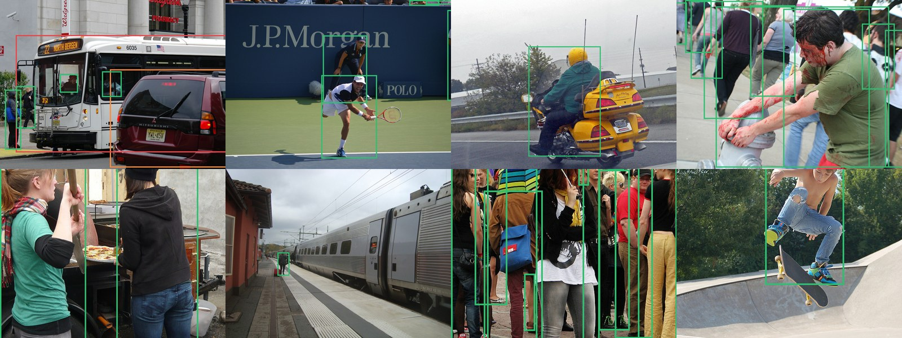

  

# Day 09 Lab — Pipeline kiểm nhãn tự động

  
  
  
  
  
  

> **Máy kiểm quy tắc, người kiểm ý nghĩa.** Bạn xây một pipeline chạy bằng MỘT lệnh, rồi **đo** (số liệu, trung thực) xem nó có ích không.

Bạn nhận một lô **224 ảnh** đã được gán nhãn sẵn. Trong lô có đủ loại lỗi:
ảnh hỏng, ảnh trùng, ảnh rò rỉ từ tập test, file nhãn mất, ID lớp sai, box tràn ảnh, box lỏng, thiếu nhãn, gán nhầm lớp…
Việc của bạn là **xây một pipeline tự động** — một lệnh chạy từ ảnh thô đến bộ dữ liệu sạch — rồi **đo bằng thí nghiệm**
(train trên Google Colab) xem dữ liệu sau pipeline có cho model tốt hơn dữ liệu gốc hay không, và báo cáo trung thực.

Bạn sẽ **tự viết 4 module** (`label_format`, `second_opinion`, `autofix`, `gate`, xem [GUIDE.md](GUIDE.md)); 5 check đã viết sẵn làm mẫu, phần còn lại
(orchestrator, người duyệt mô phỏng, xuất, train) đã có sẵn để bạn tập trung vào **kiểm tra chất lượng nhãn**.

## Bộ dữ liệu

224 ảnh COCO val2017 (CC BY 4.0; xem [data/ATTRIBUTION.csv](data/ATTRIBUTION.csv)): **raw 224** (cần QC) · **calib 39** (có đáp án lỗi, để chọn ngưỡng) · **gold_val 40** · **test 100** (chỉ để đo cuối). Chi tiết: [data/README.md](data/README.md).

## Bắt đầu nhanh (5 bước, ~4,5 giờ, không tính train)

1. Mở https://github.com/VinUni-AI20k/K5-L23-Day09-AutoQC-Pipeline-Lab → **Use this template** → repo **public** của bạn (tên: xem [SUBMISSION.md](SUBMISSION.md)), `git clone`, cài môi trường ([docs/SETUP.md](docs/SETUP.md)): `python -m pytest -q` ra **55 failed, 24 passed** (đúng dự kiến).
2. **Viết 4 module** theo [GUIDE.md](GUIDE.md) (TDD, ~2 giờ 15') đến khi `pytest` xanh hết.
3. `make calibrate` chọn **2 ngưỡng** (thưởng +2: CVAT, [docs/CVAT_FILTER.md](docs/CVAT_FILTER.md), nhãn ở [cvat/labels.json](cvat/labels.json)).
4. `make run` (kết luận Release/Hold/Rework). **Tùy chọn, chấm riêng 15 điểm:** push rồi train trên Colab ([docs/COLAB.md](docs/COLAB.md), ~20 phút chạy nền).
5. Viết `submission/REPORT.md` (1–2 trang), `make check-core` hết LỖI → nộp (đã train thì `make check`).

> **Khi nộp:** đổi dòng tiêu đề README thành `# Day 09 Lab — <Họ và tên>: <MSHV> - <Họ và tên>`.
> Windows không có `make`: chạy thẳng lệnh `python ...` trong [Makefile](Makefile). Mã thoát `python -m pipeline.run`: 0 Release · 10 Hold · 20 Rework · 30 tạm dừng chờ người duyệt.

<b>Vì sao cổng Hold ở 10% và ngân sách duyệt chỉ 80 ảnh?</b>

Slide ví dụ ngưỡng 2% ("dự án đặt trong guideline"). Ở lab, hàng đợi người duyệt có 80 ảnh trên ~200 ảnh nên chọn 10%. Ảnh chưa duyệt vẫn tính vào tỉ lệ cảnh báo: ngân sách không đủ thì **không** được Release. Xem [GUIDE.md](GUIDE.md).

<b>Máy yếu / Windows / không GPU?</b>

- Không cần GPU cho pipeline: chỉ train mới cần ([Colab](docs/COLAB.md) hoặc Kaggle).
- Windows: dùng Git Bash/WSL chạy nguyên lệnh `make`, hoặc chạy trực tiếp lệnh `python` (đặt `PYTHONUTF8=1`).
- CVAT chỉ là phần thưởng +2: không có cũng không sao.

## Bạn sẽ có gì sau bài này

| Sản phẩm | Ở đâu |
|---|---|
| Bộ kiểm tự động (4 module bạn viết + 5 check mẫu), unit test xanh | `pipeline/`, `tests/` |
| **Danh sách lỗi** trước / sau sửa / sau người duyệt, log các thay đổi, hàng đợi người duyệt | `submission/reports/` |
| **Kết quả calibration** (2 ngưỡng): sweep precision/recall | `submission/calibration/` |
| Dataset đã xuất + `manifest.json` (truy vết) | `submission/export/clean_v1/` |
| *(tùy chọn)* **So sánh train**: raw vs clean (2 seed) | `submission/results/` |
| **Một báo cáo duy nhất**: quyết định Release/Hold/Rework, phân việc, calibration, kết luận train | `submission/REPORT.md` |

## Tài liệu

| Bạn cần | Xem |
|---|---|
| Các pha làm việc, lệnh, mốc giờ | [GUIDE.md](GUIDE.md), [CHECKPOINTS.md](CHECKPOINTS.md) |
| Quy tắc, dùng AI | [RULES.md](RULES.md) |
| Chấm điểm | [RUBRIC.md](RUBRIC.md) |
| Nộp bài | [SUBMISSION.md](SUBMISSION.md) |
| Dữ liệu, 22 mã lỗi, nguồn ảnh | [data/README.md](data/README.md) |
| Kiến trúc pipeline, vào/ra từng bước | [docs/PIPELINE.md](docs/PIPELINE.md) |
| Calibration là gì, đọc bảng sweep | [docs/CALIBRATION.md](docs/CALIBRATION.md) |
| Prompt AI viết script (4 ý), kiểm code AI | [docs/PROMPTING.md](docs/PROMPTING.md) |
| Lọc box nhỏ trong CVAT (thưởng +2, tùy chọn) | [docs/CVAT_FILTER.md](docs/CVAT_FILTER.md) |
| Cài đặt môi trường | [docs/SETUP.md](docs/SETUP.md) |
| Train trên Colab | [docs/COLAB.md](docs/COLAB.md), [notebooks/day09_train_compare.ipynb](notebooks/day09_train_compare.ipynb) |
| Nhãn dự án cho CVAT | [cvat/labels.json](cvat/labels.json) |

Slide tham khảo: **Day 09 — Công cụ kiểm tự động & Pipeline cơ bản**. Nền tảng: Day 07 (QC, Release/Hold/Rework).

## Bạn học được gì

- Chia việc đúng: **máy** kiểm quy tắc (thiếu nhãn, ID, tràn ảnh, trùng), **người** kiểm ý nghĩa.
- Viết check có **test**, nối thành pipeline một lệnh với **cửa chặn** Release / Hold / Rework và mã thoát cho CI.
- **Calibration**: chọn ngưỡng bằng bộ calib có đáp án, nhận ra khi tối ưu cho calib mà hại dữ liệu thật.
- Thí nghiệm train công bằng và **kết luận trung thực** khi chênh lệch nằm trong nhiễu.

Hình trong `docs/assets/` do giảng viên vẽ bằng `docs/assets/make_figures.py`; ảnh mẫu từ COCO val2017 (CC BY 4.0).
