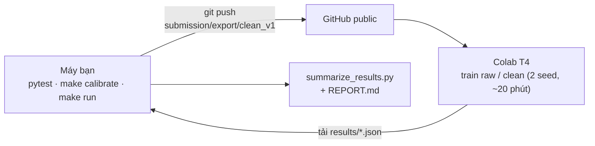

# Train trên Google Colab

*(badge trỏ vào repo mẫu; với repo của bạn đổi `VinUni-AI20k/K5-L23-Day09-AutoQC-Pipeline-Lab` thành `<tài-khoản>/<tên-repo>`. Repo phải **public**.)*

Chỉ phần **train** cần GPU (T4 miễn phí). Pipeline, calibration và báo cáo chạy ngay trên máy bạn.

1. Chạy `make run` (đã Release/Hold), **commit và push** `submission/export/clean_v1/` (kèm `manifest.json`).
2. Mở notebook từ badge trên (hoặc Colab → File → Open notebook → GitHub → dán URL repo). Runtime → **T4 GPU**.
3. Chạy lần lượt các ô: cài đặt, clone repo của bạn, train `raw` và `clean` với 2 seed, 20 epoch, tải `results/*.json` về `submission/results/`.
4. Trên máy: `python scripts/summarize_results.py` → `comparison.md`, rồi dán vào `REPORT.md` mục 5.

**Hết quota GPU?** Kaggle Notebook (bật Internet) chạy y hệt; hoặc rút gọn cục bộ `--epochs 15 --imgsz 416 --device cpu` (ghi rõ cấu hình rút gọn trong `REPORT.md`).
Chênh lệch giữa raw và clean thường **nằm trong nhiễu** (test 100 ảnh): hãy báo cáo trung thực.
